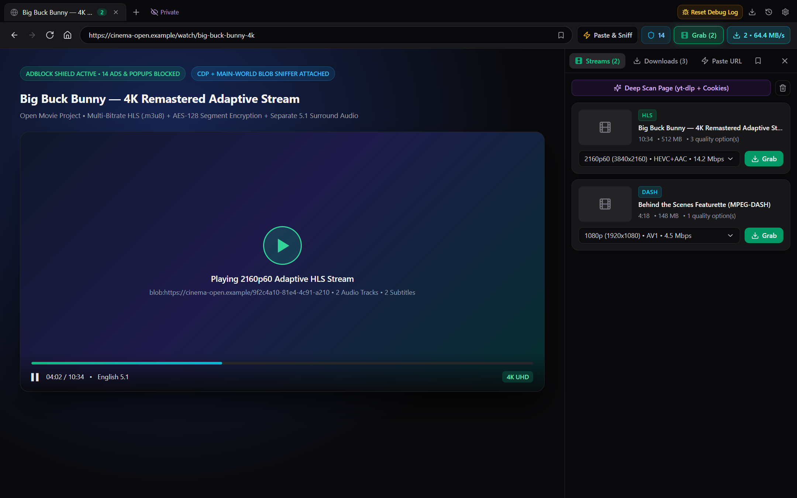
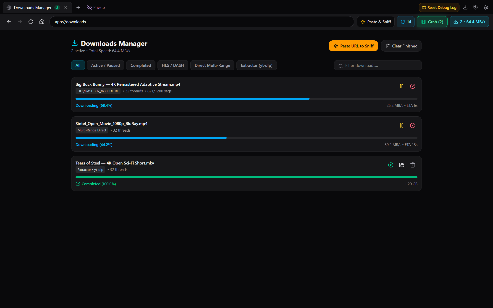
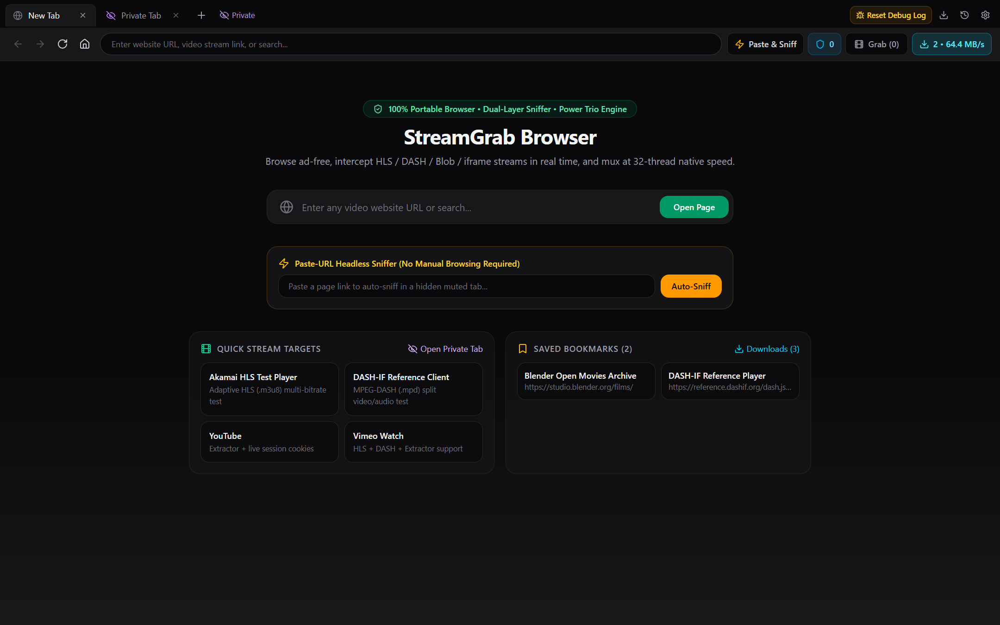
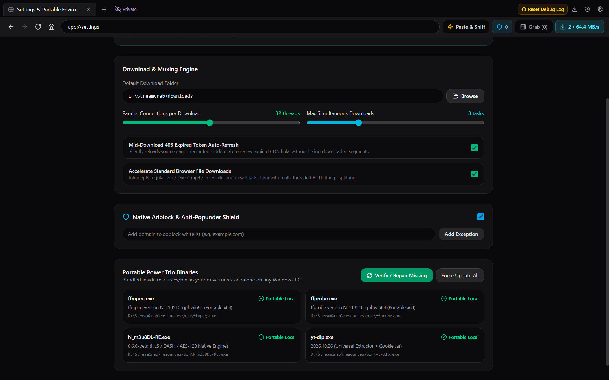
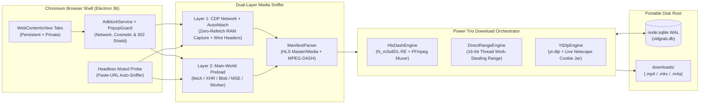

<div align="center">

# StreamGrab Browser

**A 100% portable, all-in-one desktop browser, native ad/popup shield, dual-layer stream sniffer, and 32–64 thread media downloader for Windows.**

[](https://github.com/mtaelp/streamgrab/releases)
[](https://github.com/mtaelp/streamgrab/actions/workflows/release.yml)
[](#architecture--how-it-works)
[](#build-from-source)
[](#quick-start-portable-exe)
[](#license)

[Features](#-key-features) • [Screenshots](#-screenshots) • [Quick Start](#-quick-start-portable-exe) • [How It Works](#-architecture--how-it-works) • [Build from Source](#-build-from-source) • [GitHub Releases CI](#-automated-single-exe-releases-github-actions)

</div>

---



## Overview

**StreamGrab Browser** combines a privacy-focused Chromium browser, real-time stream inspector, and high-concurrency download manager into a single, self-contained portable Windows application. Instead of juggling browser extensions, external CLI scripts, cookie exporters, and adblockers that break on cross-origin `<iframe>` players or `blob:` streams, everything runs natively under one roof:

1. **Browse ad-free** with network-level adblocking and strict clickjacking/pop-under protection.
2. **Play any video** (or paste a page URL into the **Headless Sniffer** without opening the page manually).
3. **Pick exact tracks** — resolution (`4K` / `1080p` / `720p`), audio language, subtitles, or audio-only extraction — and grab at **up to 64 parallel connections** with automatic `FFmpeg` muxing into `.mp4` or `.mkv`.

---

## Key Features

### Dual-Layer Stream Sniffer (Zero-Refetch & Anti-Obfuscation)
- **Layer 1 — Chromium DevTools Protocol (`CDP`):** Attaches `Network` + `Target.setAutoAttach` across the main page, nested cross-origin `<iframe>` embeds, and Dedicated/Shared Workers. Reads manifest bodies directly from Chromium's RAM buffer (`Network.getResponseBody`) so single-use signed tokens are never burned by a second fetch.
- **Layer 2 — Main-World JS & MSE Hooks:** Intercepts `fetch`, `XMLHttpRequest`, `Blob`, `URL.createObjectURL`, `MediaSource.addSourceBuffer`, and Worker `BroadcastChannel` payloads to catch in-memory `blob:` manifests and disguised streams served behind `.txt`, `.png`, or extensionless URLs.
- **Smart Deduplication & Track Grouping:** Automatically groups separate `#EXT-X-MEDIA` audio/subtitle renditions under their parent Master HLS/DASH card and separates short pre-roll ad clips from full-length episodes.
- **Paste-URL Headless Sniffer:** Paste a link to spin up a hidden, muted background `WebContentsView` that auto-triggers playback, captures the stream manifest, and surfaces quality options without manual browsing.

### Power Trio Download & Muxing Engine
| Engine | Best For | Highlights |
| :--- | :--- | :--- |
| **`N_m3u8DL-RE` + `FFmpeg`** | HLS (`.m3u8`), MPEG-DASH (`.mpd`), `AES-128` encrypted streams | 32–64 concurrent segment threads, exact per-host wire header & `no-referrer` replay, multi-audio/subtitle track selection, automatic `.mp4`/`.mkv` muxing |
| **`DirectRangeEngine`** | Direct `.mp4`, `.mkv`, `.webm`, `.zip`, `.exe` files | Built-in 16–64 thread HTTP `Range` splitter with dynamic work-stealing (halves the slowest remaining chunk) and SQLite WAL crash-safe resume |
| **`yt-dlp` + Cookie Jar** | 1,000+ streaming platforms & complex extractors | Deep-scans pages on demand while automatically exporting live Chromium `HttpOnly` session & age-gate cookies in Netscape format |

### Native Adblock & Strict Anti-Popup Shield
- Powered by `@ghostery/adblocker-electron` (**EasyList**, **EasyPrivacy**, **uBlock**, **Peter Lowe**, **AdGuard Regional**, and **AdGuard Popups** filters) for network + cosmetic banner/pre-roll blocking.
- **Strict `PopupGuard`:** Blocks both 0-day cross-origin ad popups *and* sneaky same-domain `302` redirector popups triggered by invisible overlays over video players, while keeping genuine OAuth login dialogs (`Google`, `GitHub`, `Microsoft`, `Apple`, `Discord`) working and offering a non-intrusive `[Open Tab]` toast button when needed.

### Mid-Download `403` Token Auto-Refresh
- If a CDN link's signed token expires mid-download (`HTTP 403`), StreamGrab pauses the task, silently reloads the original watch page in a hidden muted tab, matches the refreshed stream signature, swaps in the new token/headers, and resumes without losing already-downloaded segments.

### 100% True Portable Design
- Zero registry edits and zero files written to `C:\Users\<you>\AppData` during normal portable use.
- All Chromium profiles, cookies, bookmarks, SQLite WAL state (`vidgrab.db`), and downloads live in `data/` and `downloads/` right next to `StreamGrabBrowser-Portable-<version>.exe`.

---

## Screenshots

### 1. Multi-Threaded Power Trio Download Manager
Real-time telemetry across `N_m3u8DL-RE`, multi-range HTTP, and `yt-dlp` tasks with thread counts, segment progress, aggregate speed, and ETA:



### 2. Start Dashboard, Private Tabs & Headless Sniffer
Multi-tab Chromium strip with isolated ephemeral **Private** tabs (`incognito` partition), quick stream test targets, bookmarks, and 1-click **Paste-URL Headless Sniffer**:



### 3. Engine Tuning (`1–64` Threads) & Bundled Portable Binaries
Configure up to **64 parallel connections per download** (defeating per-socket CDN rate limits), toggle `403` token auto-refresh, manage domain adblock exceptions, and verify or update companion binaries in place:



---

## Quick Start (Portable `.exe`)

1. Go to the [**Releases**](../../releases) page and download **`StreamGrabBrowser-Portable-<version>.exe`**.
2. Place the `.exe` in any folder (e.g. `D:\StreamGrab\` or a USB SSD) and double-click it — **no installation or administrator rights required**.
3. All 4 media binaries (`ffmpeg.exe`, `ffprobe.exe`, `N_m3u8DL-RE.exe`, `yt-dlp.exe`) are already bundled inside the `.exe`:
   - `data/` and `downloads/` are created automatically right next to the `.exe`.
   - Open any site, start playing a video, click the green **`Grab (N)`** button in the top-right toolbar, choose your resolution/audio/container, and click **`Grab`**.

---

## Architecture & How It Works



### Project Structure

```text
├── .github/workflows/
│   └── release.yml                # CI/CD: builds, tests & publishes single-file portable .exe
├── resources/bin/                 # Portable companion binaries (ffmpeg, ffprobe, N_m3u8DL-RE, yt-dlp)
├── scripts/
│   └── setup-binaries.mjs         # Automated downloader & verifier for the 4 Windows x64 binaries
├── src/
│   ├── main/
│   │   ├── adblock/               # Ghostery adblocker + WebRequest listener multiplexer
│   │   ├── binaries/              # Portable binary health checker & self-updater
│   │   ├── browser/               # TabManager (WebContentsView), SessionManager, PopupGuard, Stealth
│   │   ├── downloader/            # DownloadOrchestrator, HlsDashEngine, DirectRangeEngine, YtDlpEngine
│   │   ├── logger/                # Structured JSONL diagnostic logger for sniffer/popup debugging
│   │   ├── portable/              # PortablePaths & Chromium TLS RuntimeFetch
│   │   ├── sniffer/               # CDP + Main-World SnifferManager, HeadlessSniffer, ManifestParser
│   │   └── storage/               # Built-in node:sqlite WAL persistence (tasks, chunks, history, settings)
│   ├── preload/                   # Context-isolated shell API + frame-wide Main-World sniffer hook
│   ├── renderer/                  # React 19 + Tailwind v4 + Zustand UI (Toolbar, SidePanel, Views)
│   └── shared/                    # Strongly-typed IPC contracts & domain models
└── tests/                         # Unit & real AES-128 HLS + FFmpeg E2E Vitest suite
```

---

## Build from Source

### Prerequisites
- **Windows 10 / 11 (x64)**
- **Node.js 24+** (uses Node's built-in `node:sqlite`)
- **pnpm 11+**

### Setup & Run

```powershell
# 1. Clone the repository
git clone https://github.com/mtaelp/streamgrab.git
cd streamgrab

# 2. Install dependencies (stored locally in .portable-env/)
pnpm install

# 3. Download & verify FFmpeg, FFprobe, N_m3u8DL-RE, and yt-dlp into resources/bin/
pnpm run setup:binaries

# 4. Run TypeScript checks & automated unit + E2E tests
pnpm run typecheck
pnpm test

# 5. Launch in development mode
.\start-dev.cmd
```

### Package Standalone Portable `.exe` Locally

```powershell
# Produces a single self-contained executable: release/StreamGrabBrowser-Portable-1.0.0.exe
pnpm run package:exe

# Or build both the single-file .exe and unpacked folder via batch script:
.\build-portable.cmd
```

---

## Automated Single-EXE Releases (GitHub Actions)

[.github/workflows/release.yml](.github/workflows/release.yml) builds the complete single-file portable executable in the cloud on `windows-latest`:

1. Installs `Node 24` + `pnpm 11` and project dependencies.
2. Runs `node scripts/setup-binaries.mjs --force --ci` to fetch the latest Windows x64 `ffmpeg.exe`, `ffprobe.exe`, `N_m3u8DL-RE.exe`, and `yt-dlp.exe`.
3. Runs `pnpm run typecheck` and `pnpm test` (including live AES-128 HLS decryption & FFmpeg muxing verification).
4. Packages `StreamGrabBrowser-Portable-<version>.exe` + `SHA256SUMS.txt` and attaches them to a **GitHub Release** whenever you push a `v*` tag:

```powershell
git tag v1.0.0
git push origin v1.0.0
```

You can also trigger a build manually anytime via **Actions -> Build & Release Portable EXE -> Run workflow** (with an optional checkbox to publish a draft release).

---

## Disclaimer

This project is an open-source browser and network protocol research tool intended solely for downloading **user-owned media, public-domain / Creative Commons content, open movies, and streams for which you hold explicit permission**. Users are solely responsible for complying with applicable copyright laws and the Terms of Service of any website they visit. StreamGrab Browser does **not** bypass Widevine/PlayReady DRM.

## License

Released under the [MIT License](https://opensource.org/licenses/MIT).
